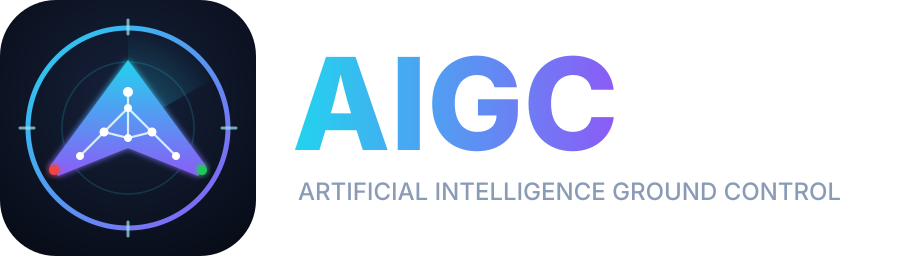

<p align="center">
  
</p>

<p align="center"><b>A ground control station for ArduPilot that you can talk to.</b><br>
Ask an AI assistant to tune your aircraft in plain English. You review and approve every change.</p>

---

**AIGC (Artificial Intelligence Ground Control)** is a fork of [QGroundControl](https://github.com/mavlink/qgroundcontrol)
built for ArduPilot planes, quads and VTOLs. It adds an AI co-pilot that **works with Claude**: you describe what you want
the aircraft to do ("it porpoises in cruise, calm the pitch loop down", "make my flight-mode switch channel 6"), and
the assistant reads your live parameters and telemetry, then *proposes* changes. Nothing is written to the flight
controller until you click **Apply**.

Each person uses **their own Claude account** through the Claude desktop app. AIGC has no shared key, no server of
its own, and no account to sign up for.

> AIGC is an independent community project. It is not made, endorsed or supported by Anthropic or the QGroundControl
> project. "Claude" is a trademark of Anthropic.

## Contents

- [What's different from QGroundControl](#whats-different-from-qgroundcontrol)
- [Download and install](#download-and-install)
- [Set up the AI co-pilot (Claude desktop app)](#set-up-the-ai-co-pilot-claude-desktop-app)
- [Using it](#using-it)
- [Safety](#safety)
- [Troubleshooting](#troubleshooting)
- [Alternative: Claude Code](#alternative-claude-code)
- [What the assistant can do (tools)](#what-the-assistant-can-do-tools)
- [Building from source](#building-from-source)
- [Credits and license](#credits-and-license)

## What's different from QGroundControl

| Feature | What it does |
| --- | --- |
| **AI co-pilot** | A local [Model Context Protocol](https://modelcontextprotocol.io) server inside AIGC. The assistant can read status, parameters and RC input, and can propose changes that you approve in a review dialog. |
| **Parameter docs that match your firmware** | ArduPilot renames and adds parameters between releases. AIGC downloads the official docs for the **exact** version on your flight controller (e.g. Plane 4.6.3) instead of the nearest bundled set, caches them for offline use, and shows which docs are loaded. |
| **Mission Planner style parameter list** | Name, Value, Default, Units, Options and Description columns, plus a details pane with the full description, range, reboot flag and a *Reset to default* button. |
| **Modified tab** | Every parameter that differs from the firmware default, with its default next to it. |
| **Undocumented tab** | Parameters on your vehicle that aren't in the docs for its version: renamed, new or removed. |
| **RC Mapping page** | *Vehicle Setup → RC Mapping.* All channels move live. Flick a switch and its channel lights up. Assign roll, pitch, throttle, yaw or the flight-mode switch, set `RCx_OPTION` and reverse channels, with conflicts flagged. |

QGroundControl's own stick calibration, flight modes, mission planning and fly views are unchanged.

**Why ArduPilot?** The AI co-pilot works through MAVLink parameters, and the firmware-matched docs and RC Mapping
page are ArduPilot features. INAV isn't supported by QGroundControl, so it isn't supported here. PX4 vehicles connect
and the assistant can read their parameters, but the extra ArduPilot pages don't apply to them.

## Download and install

Builds are produced by GitHub Actions on this repository.

1. Open the **[Releases](../../releases)** page and download the file for your computer. If there is no release
   yet, open the **[Actions](../../actions)** tab, click the latest successful **MacOS** or **Windows** run, and
   download the installer from **Artifacts** at the bottom of the run page (you must be signed in to GitHub).
2. Install:
   - **macOS (Apple Silicon M1/M2/M3/M4 and Intel):** open the `.dmg` and drag the app to *Applications*. Community
     builds aren't signed by Apple, so the first time, **right-click the app → Open → Open**. If macOS says the app
     is damaged, run this once in Terminal:
     `xattr -dr com.apple.quarantine /Applications/QGroundControl.app`
   - **Windows 10/11:** run the installer. If SmartScreen appears, click **More info → Run anyway**.
   - **Linux:** download the `.AppImage`, `chmod +x` it and run it.
3. Start the app and connect your flight controller as usual (USB, telemetry radio, or UDP/TCP).

The app currently installs under the name **QGroundControl**; that's expected.

## Set up the AI co-pilot (Claude desktop app)

You need a Claude account and the **Claude desktop app** for macOS or Windows (download it from
[claude.com/download](https://claude.com/download)), signed in with your own account. AI requests use your own
plan's usage. AIGC doesn't need an API key.

1. **Open the connection page in AIGC.** Go to *Vehicle Setup → Parameters*, click **Tools → Connect Claude…**, and
   make sure **Allow Claude to connect to QGroundControl** is checked. The page should say
   `Listening on http://127.0.0.1:5799/mcp (this computer only)`.
2. Click **Copy config**. That copies something like this, with the right path for your computer:

   ```json
   {
     "mcpServers": {
       "qgroundcontrol": {
         "command": "/Applications/QGroundControl.app/Contents/MacOS/QGroundControl",
         "args": ["--mcp-bridge"]
       }
     }
   }
   ```

   On Windows the `command` is the full path to `QGroundControl.exe`, with each backslash doubled
   (`C:\\Program Files\\...`). Always use the path the dialog gives you.
3. **Add it to Claude.** In the Claude desktop app, open **Settings** (from the Claude menu in the menu bar on macOS),
   go to **Developer → Edit Config**. This opens `claude_desktop_config.json`:
   - If the file is empty or only contains `{}`, replace everything with the copied text.
   - If it already has an `"mcpServers"` section, add only the `"qgroundcontrol": { ... }` entry inside it, separated
     from the others by a comma.

   Save the file.
4. **Fully quit and reopen Claude** (Quit from the menu, not just closing the window).
5. **Check it's connected.** In a new chat, click the **+** / *connectors* button at the bottom left of the message
   box. `qgroundcontrol` should be listed with its tools. Back in AIGC, the *Connect Claude* page shows the number of
   requests received.

Keep AIGC running while you chat. Claude talks to the open AIGC window; if AIGC is closed, Claude reports that it
can't reach it.

## Using it

Connect your aircraft in AIGC, wait for parameters to finish loading, then ask Claude things like:

- "What firmware is my plane on, and which parameters have I changed from default?"
- "My flying wing porpoises at cruise speed. Look at the pitch tuning and suggest a fix."
- "Map my flight-mode switch to channel 6 and put RTL on channel 7's 3-position switch."
- "Explain every `Q_` parameter I've modified on this tailsitter."

When Claude proposes changes, a **review dialog** opens in AIGC. It shows each parameter's current and proposed
value and Claude's reason for the change.

- Uncheck anything you don't want, then click **Apply** to write the rest to the flight controller.
- **Cancel** leaves the proposal waiting. Find it again under *Tools → Connect Claude…*.
- **Reject** tells Claude no.

Claude can only see the outcome. It can't click Apply for you.

Tip: after changing anything marked *Reboot required*, reboot the flight controller from *Parameters → Tools →
Reboot Vehicle*.

## Safety

- **Approve with care.** You are responsible for every change you apply. Read the reason and the parameter
  description in the dialog before you click Apply.
- **Changes are refused while armed.** The review dialog disables Apply until you disarm.
- **Test on the bench with props off** after mapping, failsafe or output changes, and check control surface directions
  before flying.
- **Keep a backup.** Save your parameters before a tuning session (*Parameters → Tools → Save to file…*).
- The assistant can be wrong. Treat it like a knowledgeable friend, not an autopilot.

**Privacy:** the server only listens on your own computer (`127.0.0.1`). What Claude reads, such as parameters,
telemetry and RC values, becomes part of your Claude conversation, just like anything you paste into a chat. You can
turn the connection off at any time with the checkbox in *Connect Claude…*.

## Troubleshooting

| Problem | Fix |
| --- | --- |
| `qgroundcontrol` doesn't appear in Claude | Check the JSON is valid (commas, quotes, doubled backslashes on Windows), then fully quit and reopen Claude. Under *Settings → Developer* Claude shows whether the server started and its log. |
| Claude says AIGC "is not running" | Start AIGC and leave it open. Check that *Allow Claude to connect* is ticked. |
| *Connect Claude* says it can't listen on port 5799 | Another program, or a second copy of AIGC, is using the port. Close it and toggle the checkbox off and on. |
| "Parameters are still downloading" | Wait for the parameter progress bar to finish, then ask again. |
| Docs line says *bundled, nearest version* | AIGC couldn't download the exact docs. You may be offline, or running a beta/dev or custom firmware build. It retries next time you connect. |
| Modified tab is empty | Your vehicle didn't report defaults. ArduPilot 4.1+ reports them when parameters download over MAVLink FTP. |
| macOS: "app is damaged" / won't open | See the `xattr` command under [Download and install](#download-and-install). |

## Alternative: Claude Code

If you use [Claude Code](https://code.claude.com), you can connect it to the running app directly, without the bridge:

```bash
claude mcp add --transport http qgroundcontrol http://127.0.0.1:5799/mcp
```

## What the assistant can do (tools)

| Tool | Read-only | Description |
| --- | --- | --- |
| `get_vehicle_status` | ✓ | Firmware and exact version, vehicle type, armed state, flight mode, loaded docs version, telemetry |
| `search_parameters` | ✓ | Search parameter names and descriptions; optional modified-only filter |
| `get_parameters` | ✓ | Full docs and value for named parameters (range, options, bitmask, default, reboot flag); suggests similar names if a name doesn't exist on this firmware |
| `list_modified_parameters` | ✓ | Everything that differs from default |
| `get_rc_channels` | ✓ | Live RC PWM per channel and what each channel is mapped to |
| `propose_parameter_changes` | proposes only | Opens the review dialog. Nothing is written until you approve. |
| `get_proposal_status` | ✓ | Whether you applied or rejected a proposal |

The MCP endpoint is `http://127.0.0.1:5799/mcp` (Streamable HTTP, JSON responses). `QGroundControl --mcp-bridge`
relays stdio to it for apps that launch local servers. Use `--mcp-port <n>` if you change the port.

## Building from source

AIGC builds exactly like QGroundControl. See [README.QGroundControl.md](README.QGroundControl.md) and the
[QGroundControl developer guide](https://docs.qgroundcontrol.com/master/en/qgc-dev-guide/). The AIGC additions live in:

- `src/MCP/`: MCP server, approval model and stdio bridge
- `src/FirmwarePlugin/APM/APMExactParamDocs.*`: firmware-matched ArduPilot docs
- `src/QmlControls/ParameterEditor*.qml`, `ParameterDetailsPane.qml`, `Mcp*Dialog.qml`: parameter UI and dialogs
- `src/AutoPilotPlugins/APM/APMRCMapping*`: RC Mapping page
- `resources/aigc/`: logo (`aigc-logo.svg`) and app icon (`aigc-icon.svg`)

Pushes to `feat/**` branches build macOS, Windows and Linux packages in GitHub Actions.

## Credits and license

AIGC is built on [QGroundControl](https://github.com/mavlink/qgroundcontrol) by the Dronecode Foundation and its
contributors, and on [ArduPilot](https://ardupilot.org)'s parameter documentation. Like QGroundControl, it is
dual-licensed under **Apache 2.0** and **GPL v3** (see `LICENSE-APACHE` and `LICENSE-GPL`). The AIGC logo and icon in
`resources/aigc/` are released under the same terms.
